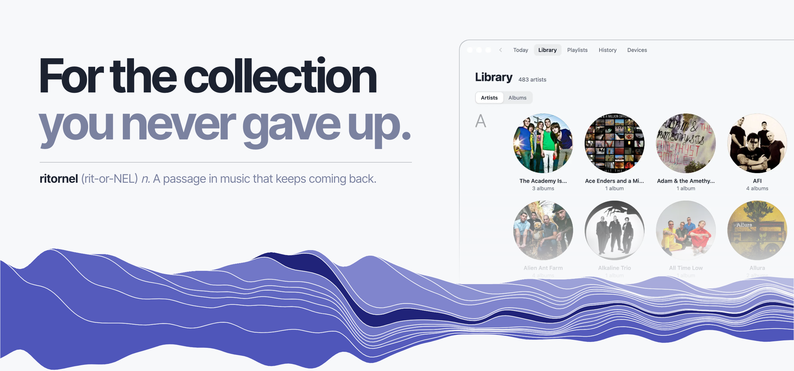

<picture>
  <source media="(prefers-color-scheme: dark)" srcset="https://raw.githubusercontent.com/ritornel/.github/main/profile/banner-dark.png">
  
</picture>

Ritornel plays the music files you own and keeps a full history of your listening, on your own machine. It is early: its author uses it every day, and there is nothing to download yet.

[ritornel.app](https://ritornel.app) · [The app's source](https://github.com/ritornel/ritornel)
